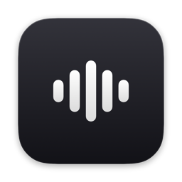

<div align="center">
  
  <h1>Murmur</h1>
  <p>Dictée locale pour macOS : on parle, le texte arrive là où on écrit.</p>
</div>

---

## Ce que fait Murmur

- **Transcription 100 % locale** avec Parakeet TDT 0.6B v3, multilingue, français compris
- **Indicateur dans l'encoche**, façon Dynamic Island : point rouge, chrono, onde de la voix
- **Raccourci mixte** : appui court pour démarrer et arrêter, appui long pour parler
- **Retouche par Claude** (facultative, clé API Anthropic) : une fois la transcription faite en local, Claude
  corrige la ponctuation, retire les hésitations et met en forme selon le mode (Haiku pour la dictée, Sonnet pour
  les mails). L'audio reste sur le Mac : part chez Anthropic le texte transcrit, plus, selon le mode, le texte
  sélectionné et une capture de l'écran comme contexte. Compter une à deux secondes de plus
- **Dictionnaire personnel** : vocabulaire et remplacements de mots
- **Discret** : ni Dock ni barre des menus ; on l'ouvre en tapant son nom dans Spotlight
- **Ne coupe pas le son** des autres apps, et les sons de dictée ne sortent que par les haut-parleurs du Mac

## Installer et mettre à jour

Prérequis : macOS 15 ou plus, Xcode avec le composant Metal Toolchain
(`xcodebuild -downloadComponent MetalToolchain`).

```bash
make install
```

Compile, signe avec le certificat Apple Development personnel et installe `/Applications/Murmur.app`.
La signature stable évite de redonner les autorisations micro et accessibilité à chaque build.

## Partager une version

```bash
make share
```

Compile une version signée ad hoc (sans compte développeur) et la publie dans les Releases de ce dépôt, avec les
instructions d'installation de `scripts/share-notes.md`. Le dépôt est privé : seuls les collaborateurs ajoutés
peuvent télécharger. Le travail doit être commité et poussé avant.

## Licence

GPLv3, voir [LICENSE](LICENSE). Murmur est dérivé de [VoiceInk](https://github.com/Beingpax/VoiceInk) de Beingpax.
