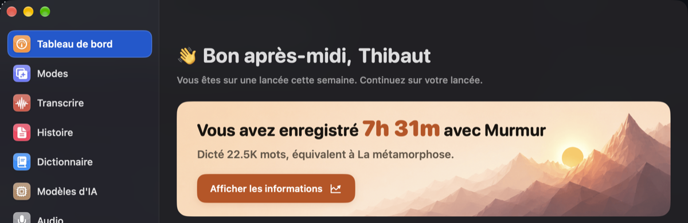
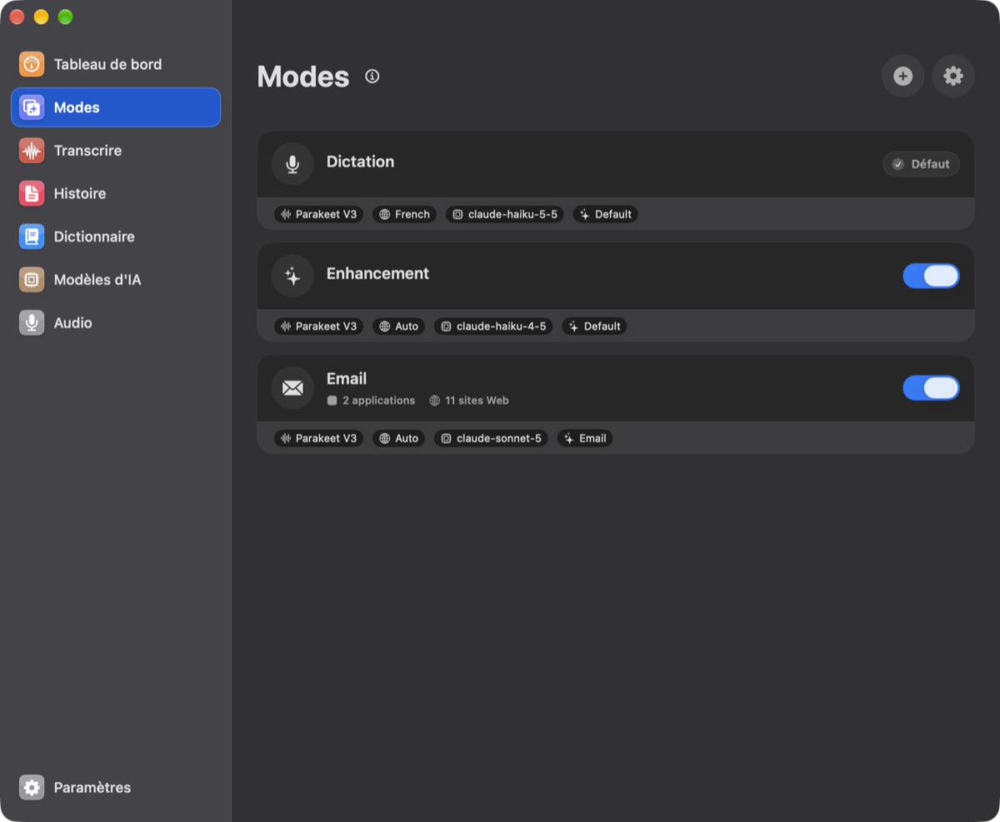
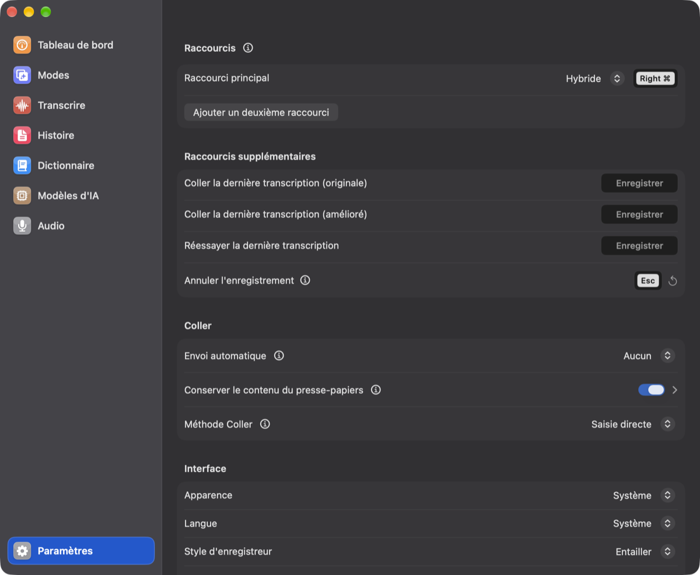
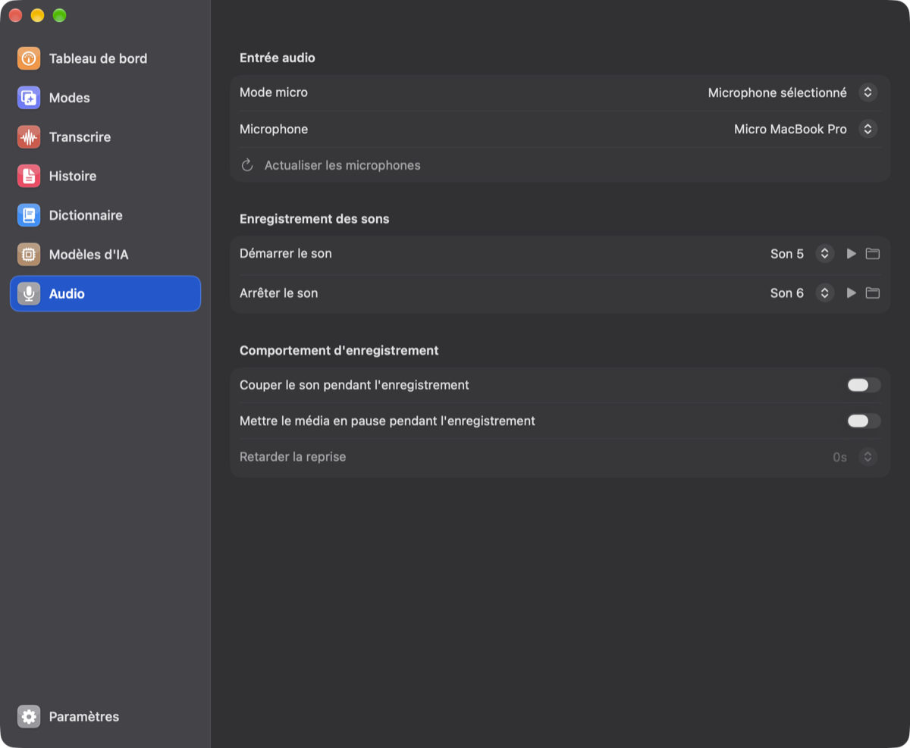

<div align="center">
  
  <h1>Murmur</h1>
  <p><strong>Dictée locale pour macOS : on parle, le texte arrive là où on écrit.</strong></p>

  <p>
    <a href="https://github.com/thibautgnt/Murmur/releases/latest"></a>
    
    
    
    <a href="LICENSE"></a>
  </p>

  <p>
    <a href="https://github.com/thibautgnt/Murmur/releases/latest"><strong>Télécharger</strong></a>
    ·
    <a href="#installer">Installer</a>
    ·
    <a href="#compiler-depuis-les-sources">Compiler</a>
  </p>

  
</div>

## Ce que fait Murmur

|     |     |
| --- | --- |
| 🎙️ **Transcription 100 % locale** | Parakeet TDT 0.6B v3 tourne sur le Mac, multilingue, français compris. L'audio ne quitte jamais la machine. |
| 🏝️ **Indicateur dans l'encoche** | Façon Dynamic Island : point rouge qui pulse, chrono, onde de la voix. |
| ⌨️ **Raccourci mixte** | Appui court pour démarrer et arrêter, appui long pour parler tant qu'on garde la touche. |
| ✍️ **Écrit sans toucher au presse-papiers** | Le texte est tapé directement dans l'app active. Dans les apps Electron (Termius, Discord, Slack…), Murmur colle puis remet le presse-papiers comme avant. |
| ✨ **Retouche par Claude** *(facultative)* | Ponctuation corrigée, hésitations retirées, mise en forme selon le mode : Haiku pour la dictée, Sonnet pour les mails. |
| 📖 **Dictionnaire personnel** | Vocabulaire et remplacements de mots. |
| 🔔 **Mises à jour intégrées** | Murmur prévient quand une nouvelle version sort et s'installe en un clic. |
| 🤫 **Discret** | Ni Dock ni barre des menus : on l'ouvre en tapant son nom dans Spotlight. Ne coupe pas le son des autres apps. |

## Aperçu

<table>
  <tr>
    <td width="50%"><p align="center"><sub>Tableau de bord</sub></p></td>
    <td width="50%"><p align="center"><sub>Modes : un réglage par usage, déclenché selon l'app ou le site</sub></p></td>
  </tr>
  <tr>
    <td width="50%"><p align="center"><sub>Raccourcis et méthode de saisie</sub></p></td>
    <td width="50%"><p align="center"><sub>Micro et sons</sub></p></td>
  </tr>
</table>

## Installer

1. Télécharger `Murmur.zip` depuis la [dernière version](https://github.com/thibautgnt/Murmur/releases/latest), le décompresser et glisser `Murmur.app` dans **Applications**.
2. L'app n'est pas signée par Apple : une seule fois, dans le Terminal :
   ```bash
   xattr -cr /Applications/Murmur.app
   ```
   À défaut : ouvrir l'app, puis **Réglages Système › Confidentialité et sécurité › Ouvrir quand même**.
3. Ouvrir Murmur et accorder le **micro** et l'**accessibilité**. Le modèle Parakeet se télécharge au premier lancement.

Ensuite, Murmur vérifie lui-même les nouvelles versions (interrupteur **Vérifier automatiquement les mises à jour**
dans les Paramètres). Après une mise à jour, macOS peut redemander les autorisations.

> [!NOTE]
> Murmur partage ses réglages et ses données avec VoiceInk : ne pas installer les deux sur le même Mac.

## Confidentialité

La transcription se fait entièrement sur le Mac. Seule la **retouche par Claude**, facultative et activée avec sa
propre clé API Anthropic, envoie du texte en ligne : le texte transcrit et, selon le mode, le texte sélectionné et une
capture de l'écran comme contexte. Compter une à deux secondes de plus par dictée quand elle est active.

## Compiler depuis les sources

Prérequis : macOS 15 ou plus, Xcode avec le composant Metal Toolchain
(`xcodebuild -downloadComponent MetalToolchain`).

```bash
make install
```

Compile, signe avec le certificat Apple Development personnel (`LOCAL_CODESIGN_IDENTITY` dans le `Makefile`) et
installe `/Applications/Murmur.app`. La signature stable évite de redonner les autorisations micro et accessibilité
à chaque build.

### Publier une version

```bash
make share
```

Compile une version signée ad hoc (sans compte développeur) et la publie dans les
[Releases](https://github.com/thibautgnt/Murmur/releases) avec les instructions de `scripts/share-notes.md`. Le
travail doit être commité et poussé avant ; les apps déjà installées proposeront la mise à jour.

## Licence et crédits

GPLv3, voir [LICENSE](LICENSE). Murmur est dérivé de [VoiceInk](https://github.com/Beingpax/VoiceInk) de Beingpax,
dont il suit les évolutions. Si Murmur vous plaît, pensez à soutenir le projet d'origine.
