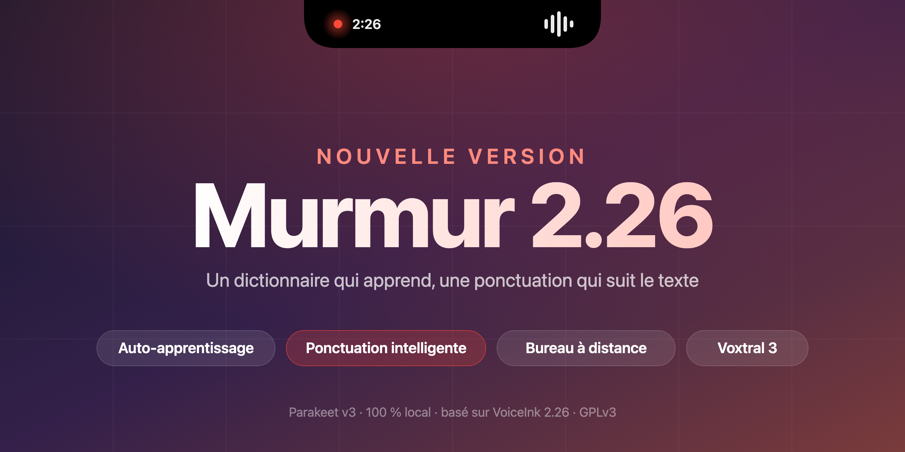

  

<strong>Murmur rattrape VoiceInk 2.26 : un mois de nouveautés, sans rien perdre de ce qui fait Murmur.</strong>

## ✨ Les nouveautés

### 🧠 Un dictionnaire qui apprend tout seul
Quand vous corrigez un mot mal transcrit dans le texte dicté, Murmur le repère. Un modèle, local ou celui de votre choix, vérifie la correction puis l'ajoute au dictionnaire : la fois suivante, le mot sort juste. Réglages dans **Dictionnaire > Apprentissage automatique**.

### ✍️ Ponctuation intelligente
Le texte s'adapte à ce qui l'entoure : pas de majuscule au milieu d'une phrase, pas de point en trop, les bons espaces. Si Murmur ne peut pas lire le texte autour, il colle votre dictée telle quelle. À activer dans **Paramètres > Ponctuation intelligente**.

### 🖥️ Saisie pour bureau à distance
Une nouvelle méthode de collage, pensée pour les bureaux à distance et les machines virtuelles qui ignorent le presse-papiers du Mac.

### 🗣️ Plus de modèles
Voxtral 3 et Mistral Large 4, Soniox v6, AssemblyAI Universal 3.6 Pro et ElevenLabs Scribe v2 Medical. Le streaming Soniox et ElevenLabs est nettement plus stable.

## 🔧 Plus fiable au quotidien

- **Enregistreur sur le bon écran** : il s'ouvre sur l'écran où se trouve le curseur et y reste jusqu'à la fin.
- **Micro bloqué** : quand l'audio de macOS se fige, Murmur l'explique et propose de le redémarrer, au lieu d'une erreur vague.
- **Raccourci d'enregistrement** : il ne reste plus bloqué quand le relâchement de la touche passe inaperçu.
- **Contexte de l'IA** : meilleure lecture du texte sélectionné et de l'écran, avec un repli quand l'accessibilité ne répond pas.
- **Modes par site web** : les règles se basent sur le domaine et ne se trompent plus sur un chemin ou un port.
- **Mises à jour** : Murmur vous prévient d'une nouvelle version même quand sa fenêtre est fermée.
- **Japonais** : nouvelle langue d'interface.

## 🏝️ Toujours là

L'île dans l'encoche avec son halo, la frappe directe qui laisse votre presse-papiers tranquille, le français et le mode mixte par défaut, la retouche par Claude, et la transcription **100 % locale** avec Parakeet v3.

---

## 📦 Installer ou mettre à jour

1. Télécharger `Murmur.zip` ci-dessous, le décompresser et glisser `Murmur.app` dans **Applications**.
2. Dans le Terminal, une seule fois : `xattr -cr /Applications/Murmur.app`
   (l'app n'est pas signée par Apple ; sans cette commande, macOS refuse de l'ouvrir).
   À défaut : ouvrir l'app, puis Réglages Système > Confidentialité et sécurité > « Ouvrir quand même ».
3. Ouvrir Murmur et accorder le **micro** et l'**accessibilité**. Le modèle Parakeet se télécharge au premier lancement.

Déjà installé ? Murmur propose lui-même cette version (Paramètres > Vérifier automatiquement les mises à jour). macOS peut redemander les autorisations après la mise à jour.

Pour la retouche par Claude, mettre sa propre clé API Anthropic dans les réglages. Ne pas installer en parallèle de VoiceInk : les deux apps partagent leurs réglages et leurs données.

Le code source de cette version est celui du commit indiqué par l'étiquette. Licence GPLv3, dérivé de [VoiceInk](https://github.com/Beingpax/VoiceInk).
